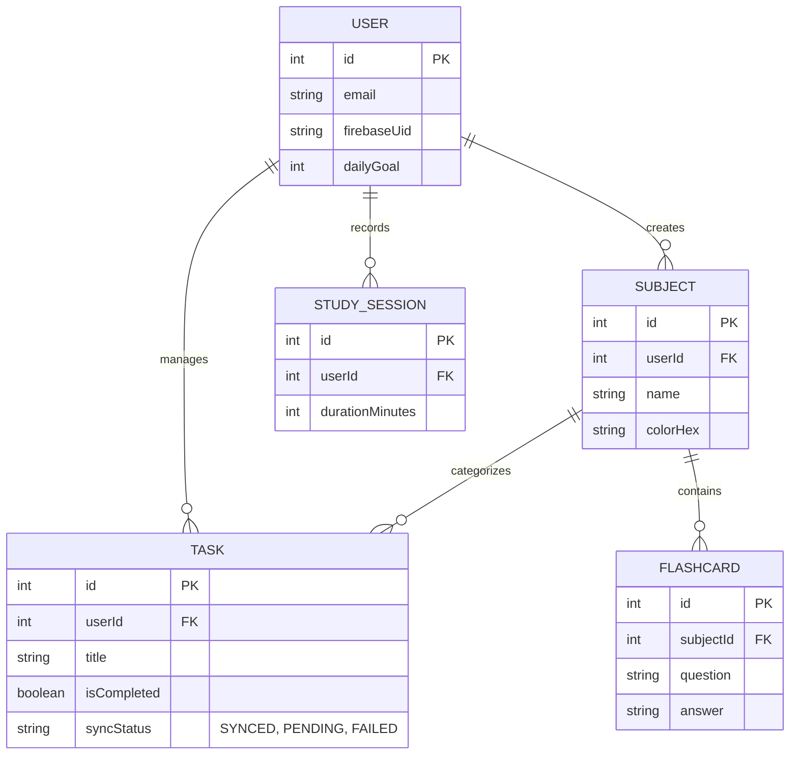

# StudyFlow - Advanced Productivity & Cloud Sync App

**Student Name:** Lesego Mathe More  
**Student Number:** ST10451027  
**Course:** OPSC6312  
**Assessment:** Final PoE (Part 3)  

**Video Demonstration:** **[INSERT YOUR YOUTUBE LINK HERE]** *(Note: Video is unlisted and demonstrates the app running on a physical device).*


## Introduction
StudyFlow is an advanced, cloud-connected Android academic productivity application developed to help students manage their academic responsibilities in one centralised app.

Building upon the Part 2 prototype, this Final PoE version transforms the app into a fully-featured, modern application. It incorporates Firebase Authentication (SSO), Cloud Firestore for data syncing, advanced study tools (Pomodoro Focus Mode and 3D Flashcards), multi-language support, and local push notifications. The app uses an offline-first architecture, meaning it works perfectly without internet, and automatically syncs to the cloud once the device reconnects.

---

## Feature Highlights

*   **Firebase Integration:**
    *   **SSO:** Secure Google Sign-In using Firebase Authentication.
    *   **Offline Sync:** WorkManager and Firebase Firestore handle the upload of `PENDING` tasks when the device reconnects to the internet.
*   **Dashboard:** A modern home screen featuring a Daily Streak tracker, daily study goal progress, and quick stats.
*   **Task & Subject Manager:** Create, edit, and delete tasks with swipe-to-delete functionality and color-coded subjects.
*   **Pomodoro Timer:** A 25-minute countdown timer with a circular progress animation. Includes a toggle for looping rain sounds, and upon completion, it saves the session and triggers a confetti animation.
*   **3D Flip Flashcards:** Users can create flashcards linked to subjects. Features a smooth 3D flip animation (`rotationY`) to reveal answers and swipe gestures to track learning progress.
*   **Multi-Language Support:** Switch between English, isiZulu, and Sesotho directly in the Settings screen using `AppCompatDelegate.setApplicationLocales()`.
*   **Local Notifications:** Uses `AlarmManager` and `NotificationManager` to schedule reminders for upcoming task due dates.

---

## Tech Stack & Architecture
*   **Language:** Kotlin
*   **UI Framework:** Jetpack Compose with Material 3
*   **Architecture:** MVVM (Model-View-ViewModel) + Repository Pattern
*   **Local Database:** SQLite via Android Room (`studyflow.db`)
*   **Cloud Backend:** Firebase Auth (SSO) & Cloud Firestore (Data Sync)
*   **Asynchronous Processing:** Kotlin Coroutines & Flow, WorkManager (for background syncing).

### Hybrid Database Schema (Local Room + Cloud Firestore)


---

## Release Notes (Since Part 2 Prototype)
The following updates were made to transition the Part 2 prototype into the Final PoE submission:
*   **NEW:** Implemented Firebase Authentication for Google Single Sign-On (SSO).
*   **NEW:** Integrated Firebase Cloud Firestore and WorkManager to handle Offline Sync (uploading PENDING tasks).
*   **NEW:** Added Pomodoro Focus Mode with timer, ambient sounds, and confetti animation.
*   **NEW:** Added 3D Flip Flashcards with swipe gestures for spaced repetition.
*   **NEW:** Implemented Multi-Language support (English, isiZulu, and Sesotho).
*   **NEW:** Added Local Push Notifications for task reminders using AlarmManager.
*   **NEW:** Added custom App Icon and Splash Screen.
*   **IMPROVEMENT:** Overhauled the entire UI with Material 3.
*   **FIX:** Optimized Coroutines/Flow to prevent previous UI hanging issues.

---

## AI Tools Declaration
*(Max 500 words)*
In compliance with the PoE requirements, Android Studio's built-in Gemini AI was heavily utilised during the development of StudyFlow. AI was used to generate the base project architecture, UI components (circular timer, 3D card flip animations), and Room database structures. The AI also played a crucial role in debugging complex Gradle dependency conflicts, particularly during the setup of Firebase Authentication, Firestore rules, and the WorkManager sync logic. All AI-generated code was manually reviewed, adapted, and thoroughly tested on physical Android devices to ensure it met the specific functional requirements of this project.

---

## GitHub Actions & Automated Testing
This repository includes a GitHub Actions workflow (`.github/workflows/build.yml`). It triggers on every push to the `main` branch to automatically build the project (`./gradlew build`) and run unit tests (`./gradlew testDebugUnitTest`), ensuring compilation success in a clean environment. *Note: Google Services JSON is mocked in the CI environment to allow the build to pass without exposing production Firebase keys.*

## Play Store Preparation
*   **Signed APK:** A signed APK has been generated and is included in this repository.
*   **Play Console:** App assets, icons, and screenshots have been prepared for Google Play Console upload.

---

## Getting Started
1. Clone the repository:
   ```bash
   git clone https://github.com/[YourUsername]/StudyFlow.git
   ```
2. Open the project in Android Studio.
3. **Firebase Setup:** You will need to connect your own `google-services.json` file from Firebase to run the SSO and Firestore features.
4. Sync Gradle files and run on an Android device (API 26+).
5. To build the debug APK via terminal:
   ```bash
   ./gradlew assembleDebug
   ```
```
